# T113 AI 小智 — 从零教学课程总览

> 本课程带你从一个空文件夹开始，在 PC 上写出完整的 AI 语音助手界面，再逐个功能地搬到开发板上，
> 最终做出一台能听会说、带表情脸的 AI 语音助手。
>
> **无需任何嵌入式经验**。默认你只会上一点 Linux 基础命令，其余的（C 语言进阶、LVGL、音频、网络、
> WiFi）全部随课讲解。

---

## 你将做出什么

一台 **T113 开发板 + 480×640 触摸屏**的 AI 语音助手：

- 点按屏幕上的"说话"按钮 → 对它说话 → 屏幕显示你说的内容（语音识别）
- AI 回答 → 喇叭播出语音回复，屏幕显示字幕气泡
- 机器人表情脸随对话情绪变化（开心/难过/惊讶/思考……）
- WiFi 配网、断线自动重连、未绑定设备显示激活码

运行效果（PC 模拟器与板上 UI 完全一致）：

```
┌─────────────────────┐
│  AI 小智     [返回]  │
│                     │
│      😊 表情脸       │   ← 随状态切换：待命/聆听/思考/说话
│                     │
│   状态行：聆听中…     │
│                     │
│  ┌───────────────┐  │
│  │ 聊天气泡区      │  │   ← 你说的话（stt）+ AI 回复（tts）
│  └───────────────┘  │
│                     │
│   ╭─────────────╮   │
│   │   🎤 说话    │   │   ← 点按开始/结束对话
│   ╰─────────────╯   │
└─────────────────────┘
```

## 课前准备

### 硬件清单

| 物品 | 说明 | 获取方式 |
|---|---|---|
| PC | x86_64 电脑，≥8G 内存，20G 空闲磁盘 | 自备 |
| T113 开发板（zgl_board） | 全志 T113-S3 + 480×640 MIPI 屏 + 触摸 + 喇叭 + MIC + WiFi 模块 | 随课程发放 |
| 5V 电源 | 板子供电 | 手机充电器即可 |
| USB 双公头线 | 连接 PC 与板的 OTG 口，用于 adb 通信 | 随课程发放 |
| Ubuntu 电脑 | 上述 PC 装 Ubuntu 20.04 / 22.04 / 24.04 任一（双系统、虚拟机、WSL2 均可） | 自装 |
| xiaozhi.me 账号 | 官方 AI 服务器，邮箱注册 | 第 20 课时注册 |

> **提示**：第 3-10 课（UI 部分）完全不碰板子，可以先跟着课程把 UI 部分学完再决定要不要买板子。
> 但功能部分（第 11 课起）必须有板子。

### 软件环境

- **Ubuntu 20.04 / 22.04 / 24.04**（20.04 已停止维护，第 1 课会教你换 old-releases 源）
- 磁盘 ≥20G（工具链 + 构建目录 + 资源包）

### 课程资源包

课程不提供代码仓库，一切代码从文档复制、从零写出。所需的**第三方源码、素材、工具链、系统镜像**
统一放在课程资源包 `t113-xiaozhi-course-pack.zip`（开课时发放），内含：

```
t113-xiaozhi-course-pack.zip
├── mirror/t113_linux_zgl_board_uart0.img   # 开发板系统镜像（第 2 课烧录）
├── phoenixsuit/                            # 烧录工具（Windows，第 2 课）
├── toolchain/                              # 交叉编译工具链 gcc-8.3.0 armhf（第 11 课放入项目）
├── libs/
│   ├── include/                            # openssl/alsa/opus/speex 头文件（第 13-19 课）
│   └── lib/                                # libopus.a / freetype / ssl / crypto / asound / speexdsp（同上）
├── third_party/                            # LVGL 8.3.1 / lv_drivers / cjson 源码（第 4 课放入项目）
├── assets/                                 # 表情脸 PNG + 背景图 + 菜单图标 + 中文字体 otf（第 6-8 课）
└── config.ini                              # 小智服务器配置模板（第 20 课）
```

> 注：烧录系统镜像需要一台 Windows 电脑（虚拟机里的 Windows 也行），只在"刷机"时用到。
> 烧录完成后日常开发全在 Ubuntu 里进行（adb 部署）。

## 学习路线图

```mermaid
flowchart TD
    subgraph P1["第一部分 · 基础环境"]
        L01["01 环境搭建<br/>Ubuntu 20/22/24 + 编译工具"]
        L02["02 初识开发板<br/>烧录镜像 + adb 连板"]
    end

    subgraph P2["第二部分 · UI 先行（纯 PC，不碰板子）"]
        L03["03 项目骨架<br/>目录 + CMake + build.sh"]
        L04["04 LVGL HelloWorld<br/>第一个 SDL 窗口"]
        L05["05 第一个界面<br/>标签/按钮/布局"]
        L06["06 表情脸动画<br/>lv_img + timer 换帧"]
        L07["07 中文字体<br/>FreeType 渲染中文"]
        L08["08 主页 UI<br/>背景+表情+状态行+气泡"]
        L09["09 配网页 UI<br/>AP 列表 + 密码键盘"]
        L10["10 导航框架<br/>三页互切"]
    end

    subgraph P3["第三部分 · 功能逐个板测"]
        L11["11 部署到开发板<br/>交叉编译 + adb 部署"]
        L12["12 OSAL 基础<br/>日志/线程/锁/时基"]
        L13["13 音频采集<br/>ALSA 录音"]
        L14["14 音频播放<br/>解码→重采样→ALSA"]
        L15["15 opus 编解码<br/>录→编→解→放闭环"]
        L16["16 WiFi 管理<br/>wpa_supplicant 交互"]
        L17["17 配网 UI 接真数据<br/>扫描/连接/持久化"]
        L18["18 TLS 与 HTTP<br/>OTA 注册拿验证码"]
        L19["19 WebSocket 客户端<br/>RFC6455 + TLS"]
        L20["20 小智协议<br/>hello/stt/tts/emotion"]
        L21["21 完整语音对话<br/>全链路联调"]
        L22["22 事件总线与状态机<br/>断线重连"]
    end

    L23["23 完整联调与发布"]

    L01 --> L02 --> L03 --> L04 --> L05 --> L06 --> L07 --> L08 --> L09 --> L10
    L10 --> L11 --> L12 --> L13 --> L14 --> L15 --> L16 --> L17 --> L18 --> L19 --> L20 --> L21 --> L22 --> L23
```



## 课程结构

| 部分 | 课次 | 在哪开发 | 在哪验证 |
|---|---|---|---|
| 一、基础环境 | 01-02 | — | Ubuntu + 板 |
| 二、UI 先行 | 03-10 | PC（SDL 模拟器） | PC 眼见为实 |
| 三、功能板测 | 11-22 | PC 写码 + 交叉编译 | **必须板测** |
| 收尾 | 23 | 全链路联调 | 板 + xiaozhi.me |

**核心原则**：每课"验证清单"全部通过才能进入下一课。卡住先查课文末"常见问题"，再问助教。
