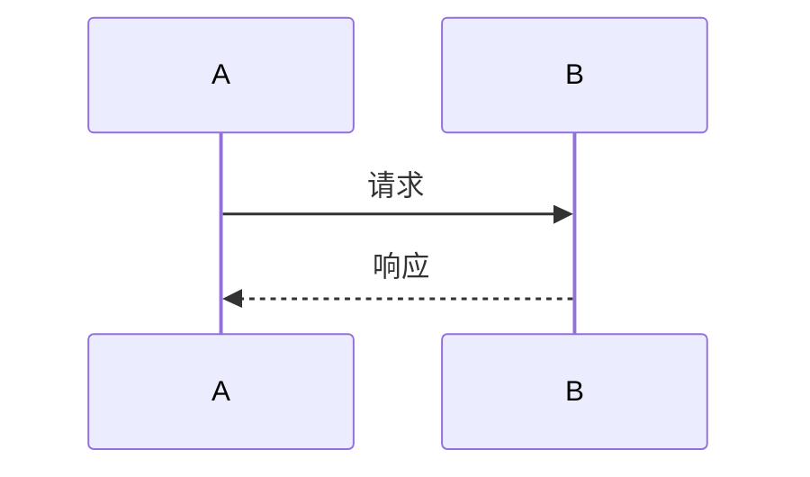

# 〈课程名〉（每课模板）

> 本模板定义每课的统一结构。写新课：复制本文件 → `NN-标题.md` → 替换各节占位内容。
> 学员可见的正文只用"正文"标注的节；`<details>` 折叠块为老师版内容（坑位/扩展练习）。

---

## 〈NN〉〈课名〉

| 课程信息 | |
|---|---|
| 前置 | 完成第 N-1 课的验证清单 |
| 预计耗时 | XX 分钟 |
| 新建/修改文件 | `path/to/file.c`（新建） |
| 本课产出 | 一句话说明做完本课你有什么 |

---

## 1. 学习目标

本课结束时，你能够：

- [ ] 〈可验证的能力 1〉
- [ ] 〈可验证的能力 2〉

## 2. 知识点讲解

> 〈概念引入：为什么需要这个东西。先讲问题，再讲方案，最后给一张概念图〉

〈正文：通俗解释，新手可懂。概念之间的比喻要贴切〉


〈术语解释表（如本课引入 3 个以上新术语）〉

| 术语 | 含义 |
|---|---|
| XXX | ... |

## 3. 动手实操

### 步骤 1：〈动作〉

```bash
〈命令〉
```

〈讲解这段命令做了什么。每条命令/每个文件都要讲**为什么**，不只是**是什么**。〉

### 步骤 2：〈创建文件〉

〈完整文件路径〉：

```c
/* 完整代码，可整段复制。文件头注释说明该文件职责 */
```

**代码讲解**：

- L10 `xxx`：为什么这样写
- L25 `yyy`：...

### 步骤 N：〈编译运行〉

```bash
./build.sh host        # PC 验证
./build.sh t113        # 板上验证（第 11 课之后）
```

## 4. 流程图

〈本课功能的数据流/状态机/调用链，mermaid。选型：
- 数据怎么流动 → flowchart
- 状态怎么翻转 → stateDiagram-v2
- 谁先谁后调用 → sequenceDiagram〉



## 5. 验证清单

做完本课后，逐条执行并确认：

```bash
# ① 〈验证 1〉
〈命令〉
# 预期输出：
```

```
〈预期输出原文〉
```

- [ ] 〈界面类验证：窗口出现/文本正确/可交互〉
- [ ] 〈命令类验证：命令成功、输出含 XXX〉

**全部通过后才能进入下一课。**

## 6. 常见问题

### 现象 1：〈学员会真实撞到的现象原文，越像真报错越好〉

```
〈报错原文/错误现象〉
```

**原因**：...

**解决**：

```bash
〈解决命令〉
```

---

<details>
<summary><b>老师版：备课注记（学员勿点）</b></summary>

- 本课对应的仓库蓝本：`component/xxx/xxx.c`（教学版简化了什么：删了 A 防御代码、B 扩展点）
- 常见卡点（来自真实开发记录）：...
- 扩展练习：...
</details>
