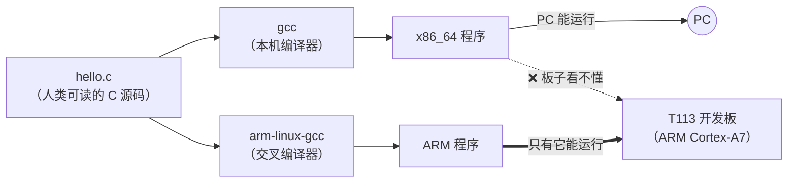
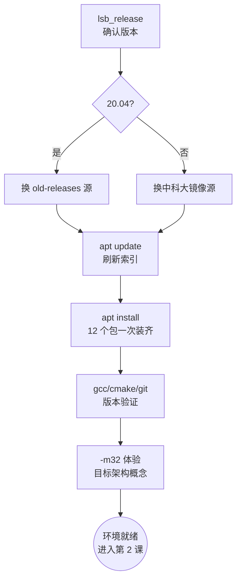

# 01 环境搭建

| 课程信息 | |
|---|---|
| 前置 | 无 |
| 预计耗时 | 30 分钟 |
| 新建/修改文件 | 无代码，只装软件 |
| 本课产出 | 一台能编译 C 程序的 Ubuntu 电脑（20.04 / 22.04 / 24.04 都适用） |

---

## 1. 学习目标

本课结束时，你能够：

- [ ] 判断自己的 Ubuntu 版本，并知道 20.04 需要额外换软件源
- [ ] 一条命令装齐全套编译工具和开发库
- [ ] 用 gcc 编译一个指定目标架构的程序（初步体验"交叉编译"概念）

## 2. 知识点讲解

### 2.1 为什么需要"交叉编译"

你的 PC 是 x86_64 架构，CPU 只能执行 x86_64 指令。开发板上的 T113 是 **ARM Cortex-A7**，
两者指令集完全不通用。PC 上编译出的程序，板子根本不认识。



所以我们需要两套编译工具：

- **本机编译器（gcc）**：编出 PC 上能跑的程序——UI 阶段（第 3-10 课）全靠它，改完代码马上
  看效果
- **交叉编译器（arm-linux-gcc）**：编出板上能跑的程序——功能阶段（第 11 课起）用。它随
  课程资源包发放，本课不用装

本课只装本机工具。

### 2.2 软件源与 apt：Ubuntu 的"应用商店"

Ubuntu 装软件用 `apt` 命令。`apt` 从**软件源**（网上的软件仓库）下载安装包。新装系统默认源
在国外，下载慢，所以第一步是换成国内镜像。

**版本判断**：Ubuntu 每个 release 有一个代号——20.04=`focal`，22.04=`jammy`，24.04=`noble`。
**20.04（focal）已于 2025 年 5 月停止标准维护**，官方把它的包从普通源移到了 old-releases
服务器，不换源会直接报 404。

| 术语 | 含义 |
|---|---|
| 软件源（repository） | Ubuntu 官方维护的软件仓库，记录在 `/etc/apt/sources.list`（24.04 在 `/etc/apt/sources.list.d/ubuntu.sources`） |
| 镜像（mirror） | 软件源在国内的完整拷贝（中科大/清华/阿里云），内容相同、下载快 |
| dev 包（-dev 结尾） | **编译程序时**需要的头文件和库说明文件。运行程序只需要运行时库，编译程序必须要 dev 包 |

## 3. 动手实操

### 步骤 1：确认 Ubuntu 版本

```bash
lsb_release -a
```

看 `Release:` 和 `Codename:` 两行。记住你的代号（focal / jammy / noble），后面换源要用。

### 步骤 2：换国内镜像源

> 也可以用图形界面：「软件和更新」→「下载自」→「其他站点」→ 选 `mirrors.ustc.edu.cn`
> → 选服务器 → 输密码，效果相同。

**Ubuntu 24.04**（新格式，配置文件在 `sources.list.d/`）：

```bash
sudo sed -i.bak \
  -e 's|http://archive.ubuntu.com/ubuntu|https://mirrors.ustc.edu.cn/ubuntu|g' \
  -e 's|http://security.ubuntu.com/ubuntu|https://mirrors.ustc.edu.cn/ubuntu|g' \
  -e 's|https://archive.ubuntu.com/ubuntu|https://mirrors.ustc.edu.cn/ubuntu|g' \
  -e 's|https://security.ubuntu.com/ubuntu|https://mirrors.ustc.edu.cn/ubuntu|g' \
  /etc/apt/sources.list.d/ubuntu.sources
```

**Ubuntu 22.04**（传统格式，配置文件是 `/etc/apt/sources.list`）：

```bash
sudo sed -i.bak \
  -e 's|http://archive.ubuntu.com/ubuntu|https://mirrors.ustc.edu.cn/ubuntu|g' \
  -e 's|http://security.ubuntu.com/ubuntu|https://mirrors.ustc.edu.cn/ubuntu|g' \
  -e 's|http://cn.archive.ubuntu.com/ubuntu|https://mirrors.ustc.edu.cn/ubuntu|g' \
  /etc/apt/sources.list
```

**Ubuntu 20.04**（已停止维护，包搬到了 old-releases.ubuntu.com，必须整体指向它）：

```bash
sudo sed -i.bak \
  -e 's|http://archive.ubuntu.com/ubuntu|http://old-releases.ubuntu.com/ubuntu|g' \
  -e 's|http://security.ubuntu.com/ubuntu|http://old-releases.ubuntu.com/ubuntu|g' \
  -e 's|http://cn.archive.ubuntu.com/ubuntu|http://old-releases.ubuntu.com/ubuntu|g' \
  /etc/apt/sources.list
```

> `sed -i.bak` 表示修改文件前先备份成 `xxx.bak`，改坏了可以还原。

### 步骤 3：刷新软件源索引

```bash
sudo apt update
```

结尾是 `Reading package lists... Done` 且**没有** `Err` / `Failed to fetch` 行即成功。

### 步骤 4：安装全套工具

```bash
sudo apt install -y \
  build-essential cmake pkg-config git \
  libasound2-dev libssl-dev libspeexdsp-dev \
  libfreetype-dev libopus-dev \
  zlib1g-dev libbz2-dev libsdl2-dev
```

每个包在本课程里的用途：

| 包 | 用途 | 哪课用到 |
|---|---|---|
| build-essential | gcc/make 等基础编译工具 | 第 3 课起 |
| cmake | 构建系统（管理几十个源文件怎么编译链接） | 第 3 课起 |
| pkg-config | 帮编译器自动定位库的头文件和路径 | 第 4 课起隐式使用 |
| git | 版本管理（随时回退你的代码快照） | 全程 |
| libasound2-dev | ALSA 音频录放开发库 | 第 13-14 课 |
| libssl-dev | OpenSSL 加密库（HTTPS/WSS 需要） | 第 18-19 课 |
| libspeexdsp-dev | 音频重采样库 | 第 14 课 |
| libfreetype-dev | FreeType 字体渲染库 | 第 7 课中文字体 |
| libopus-dev | opus 音频编解码库 | 第 15 课 |
| zlib1g-dev / libbz2-dev | 两种压缩库（freetype/openssl 的底层依赖） | 随用随装 |
| libsdl2-dev | SDL2 多媒体库——PC 模拟器的窗口与鼠标 | 第 4 课起 |

### 步骤 5：验证工具链

```bash
gcc --version | head -1
cmake --version | head -1
git --version
```

版本号不同没关系，有三行输出即可，例如：

```
gcc (Ubuntu 13.2.0-23ubuntu4) 13.2.0
cmake version 3.28.3
git version 2.43.0
```

### 步骤 6：体验"同一个源码，编出不同架构"

先不装 ARM 交叉编译器，用 gcc 的 `-m32` 选项体验"指定目标架构"这件事：

> 若报缺 32 位库：`sudo apt install -y gcc-multilib` 后重试。

```bash
mkdir -p ~/xiaozhi-course && cd ~/xiaozhi-course
cat > hello.c <<'EOF'
#include <stdio.h>
int main(void) { printf("hello xiaozhi\n"); return 0; }
EOF
gcc  hello.c -o hello64 && ./hello64
gcc -m32 hello.c -o hello32
file hello32
```

`file` 输出里的 `ELF 32-bit LSB` 说明它是 32 位程序（`hello64` 则是 64 位）。同一份源码，
给编译器指定不同目标，产出不同架构的机器码——**交叉编译本质就是这件事**，只不过 ARM 交叉
编译器把目标从"32 位 x86"换成了"ARM Cortex-A7"。第 11 课我们正式用上它。

## 4. 流程图



## 5. 验证清单

逐条执行并确认：

```bash
# ① 版本确认（记下你的代号：focal/jammy/noble）
lsb_release -a
```

```bash
# ② 源可用：结尾无 Err / Failed to fetch
sudo apt update
```

```bash
# ③ 工具链三件套
gcc --version && cmake --version && git --version
```

```bash
# ④ 关键开发库都能被找到（输出一堆 -lxxx，无 not found 即可）
pkg-config --libs alsa openssl speexdsp freetype2 opus sdl2
```

- [ ] `lsb_release -a` 能看到 Release 号
- [ ] `apt update` 无报错行
- [ ] gcc/cmake/git 都有版本输出
- [ ] 第 ④ 条输出一行 `-lasound -lssl -lspeexdsp ...`（顺序可能不同）

**全部通过后才能进入下一课。**

## 6. 常见问题

### 现象 1：`apt update` 报 `404  Not Found`

```
Err:5 http://archive.ubuntu.com/ubuntu focal Release
  404  Not Found
```

**原因**：20.04 已停止维护，archive 源里的 focal 包已搬走；或换源时代码名写错。

**解决**：按步骤 2 的 20.04 小节把源整体换成 `old-releases.ubuntu.com`，再 `apt update`。

### 现象 2：装 `libfreetype-dev` 报 `Unable to locate package`

**原因**：Ubuntu 20.04 上这个包叫 `libfreetype6-dev`（带个 6）。

**解决**：

```bash
sudo apt install -y libfreetype6-dev
```

功能完全相同，只是 20.04 的旧包名。

### 现象 3：步骤 6 报 `/usr/lib/.../crt1.o: No such file` 类错误

**原因**：没装 32 位编译支持。

**解决**：`sudo apt install -y gcc-multilib`，再重试步骤 6。这一步失败不影响后续课程，
可以跳过。

### 现象 4：WSL2 学员后续课程窗口弹不出来

**原因**：WSL2 需要 WSLg 才能显示 GUI 窗口（Windows 11 自带，Windows 10 没有）。

**解决**：Windows 11 直接用；Windows 10 建议改用 VirtualBox 虚拟机装 Ubuntu 桌面版。

---

<details>
<summary><b>老师版：备课注记（学员勿点）</b></summary>

- 本课无仓库蓝本，是纯环境课。依赖清单与 CI host-sim job 的 apt 段一致
  （`.github/workflows/build.yml`），并在 Ubuntu 24.04 上逐包验证过有候选版本。
- Ubuntu 20.04 标准 EOL 为 2025-05，此后 archive 源移除 focal，只有 old-releases 可用
  （old-releases 无国内镜像，可能较慢，可让 20.04 学员耐心或升级 22.04）。
- `-m32` 演示的教学价值是建立"目标架构"概念，第 11 课交叉编译时会呼应。全班普遍缺
  gcc-multilib 时可整体跳过。
- 扩展练习：`apt show libsdl2-dev` 看包描述；`dpkg -l | grep sdl2` 查已装版本；把
  `hello.c` 的返回值改成 3，`echo $?` 观察退出码。
</details>
